# Zombie Smash: artwork brief

Boss scene scripts, character reference pictures and console skin specs, for whoever makes new artwork for the game.

- **Part 1:** how the boss scenes work, the art direction and the file specs.
- **Part 2:** reference pictures of Joey Rob and the zombies.
- **Part 3:** the seven bosses, each with a reference picture of every form and a full scene script.
- **Part 4:** console skin specs, with exact sizes for the screen window and every button, plus a template.

Lines marked **IN GAME** are the words the game shows today. Lines marked **PROPOSED** are new suggestions you can take or leave. The picture descriptions in the scene scripts are suggestions too, so check them against your own art.

# Part 1: Boss scenes, art direction and file specs

## How the scenes work today

Every scene is a full-panel overlay on the game screen. The player can tap CONTINUE to skip ahead. The action freezes while a scene plays.

| Scene | When it plays | Length now | What the panel shows today |
| --- | --- | --- | --- |
| 1. Arrival, warning | The wave is cleared and a boss is coming | 0.7 s | "WARNING! HOSTILE APPROACHING" |
| 2. Arrival, Joey reacts | Straight after the warning | 2.1 s | Joey Rob's shocked pose and his line |
| 3. Arrival, boss reveal | Straight after Joey | 2.8 s | The boss's first form, name, title and a tease line |
| 4. Mutation | The boss changes form mid-fight | 1.8 s (2.8 s for a final form) | New form, "FORM X OF Y" and a line. On the final form of a 3-form boss Joey appears beside it |
| 5. Boss down | The boss is beaten | 3.4 s | "BOSS DOWN", the boss and their last words |
| 6. Joey down | Joey loses all his hearts or the base is overrun | 3.2 s | The boss's gloat |

The story, in the game's own words:
- Dr Mantis wants to become the **King of Proctology**.
- He has brainwashed Joey Rob's old mates and raised a zombie army.
- Every familiar face is now a boss standing in Joey's way.
- Joey's job is to free his mates, stop the harvest and hold the line.

Boss order, with the wave each one appears on:

1. Jordan (wave 2)
2. Glowing Humanity (wave 4)
3. Debo (wave 6)
4. Caffeinated Sloth (wave 8)
5. Disco Man (wave 10)
6. Fat Amy (wave 12)
7. Dr Mantis (wave 14)

## Common ingredients

- **Panel size:** portrait, about 3:4. It is designed at 343 × 450 and should be delivered at 2×, which is 686 × 900. Keep the important faces in the middle 80%, because the console frame and the CONTINUE button cover the edges.
- **Joey Rob in the shock scene:** the current picture, `joey-reaction-close.webp`, is a full-body, wide-eyed recoil pose. New scenes can keep that or use a close-up of his face, with a reaction that is specific to each boss.
- **Joey Rob in the victory scene:** a short, tired smile or a nod. Never a gloat. These are his friends.
- **Tone:** dark comedy. The bosses are friends who have been turned. The humour comes from the mates being themselves, even while brainwashed.
- **Mantis's influence:** a faint green "harvest" glow in the eyes of every brainwashed boss. It flares in each boss's mutation scenes and goes out when they are beaten.
- **Music (the new score, all in D minor):**
  - The warning scene has a doom build-up: the heartbeat speeds up and the dread stacks over the wave music.
  - A heavy impact lands when the boss appears, then the fast boss music starts.
  - A victory fanfare plays when the boss is beaten, then the wave music returns.
  - A slow tolling cadence plays when Joey falls.
  - Disco Man keeps his own track.

### The three arrival beats, for every boss

1. **Warning (0.7 s).** The screen flashes red and a klaxon sounds. The picture is a stripe of hazard tape with the boss's silhouette growing behind it.
2. **Joey reacts (2.1 s).** The camera jams in on Joey. His reaction is specific to each boss and comes before his line.
3. **Boss reveal (2.8 s).** A slow push-in on the boss in their first form. Their name and title stamp on at the bottom. The boss says their tease line and the heavy impact lands on the last beat.

## Art direction

- **Look:** gritty, painted, high-contrast and slightly comic-book. Think a tense survival film shot as a graphic novel.
- **Light:** each boss owns one saturated colour (listed in their section), with deep near-black shadows. The backdrop of the scene glows in the boss's colour.
- **Faces first:** the picture must work when seen small on a phone. Eyes, mouth and silhouette carry the scene.
- **Consistency:** Joey Rob looks the same in every scene (same face, same kit, same colours as the reference pictures in Part 2). The bosses must be recognisably the same character as their in-game sprite in each form (Part 3).
- **Comic caption:** the words appear in a cream caption box at the bottom of the panel, over the art. Leave the bottom 25% of the panel quiet, with nothing important in it.

## How the scenes look today

Today every scene is built from layers, so new artwork can be dropped in layer by layer:

1. A backdrop: a glow in the boss's colour fading to near-black, with faint radiating speed lines.
2. A Joey figure on the left and/or a boss figure on the right (transparent pictures).
3. A cream caption box with the speaker's name and the line.
4. A "CONTINUE" button.

New work can replace any of these layers, or replace the whole panel with one finished picture.

## Technical specs and file names

| Item | Size | Format | Notes |
| --- | --- | --- | --- |
| Figure (boss or Joey), the current method | 768 × 768 | PNG or WebP with a transparent background | Same size as the existing figures. Leave a small margin so nothing is cropped |
| Full-panel scene plate (replaces the layers) | 686 × 900 | PNG or WebP | Bottom 25% kept quiet for the caption box |
| Comic panel (the style of the intro story) | 1024 × 768 | PNG or WebP | Optional, for a longer "comic" moment |
| Short motion loop (optional) | 686 × 900 | MP4 or animated WebP, 2 to 3 s, loopable | Smoke, glow or sparks only |

**File names** (so the pictures can be wired in without renaming):

- Boss figures per form: `boss-<id>-stage<number>.webp`. These are the existing names, for example `boss-jordan-stage1.webp`.
- Joey reaction to a boss: `joey-react-<id>.webp`
- Warning silhouette: `scene-<id>-warning.webp`
- Boss reveal (if a finished plate): `scene-<id>-reveal.webp`
- Mutation: `scene-<id>-form<number>.webp`
- Boss down: `scene-<id>-down.webp`
- Joey down: `scene-<id>-loss.webp`

The boss ids are: `jordan`, `glowinghumanity`, `debo`, `caffeinatedsloth`, `discoman`, `fatamy`, `drmantis`.

# Part 2: Character reference, Joey Rob and the zombies

## Joey Rob

A British soldier in olive-green combat kit: a green helmet with a headset, a tan chest rig with pouches, knee pads, black gloves, boots and an assault rifle. He has short brown hair and stubble and a determined look. The name tape "JOEY ROB" and a Union flag patch are on the back of his vest. In the game he is seen from behind and above, and the full-body poses below are used in menus and scenes.

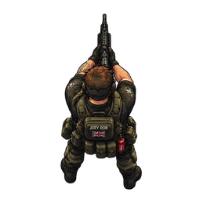
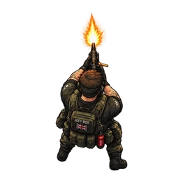
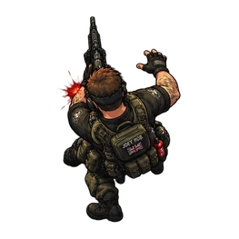
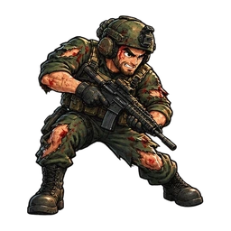
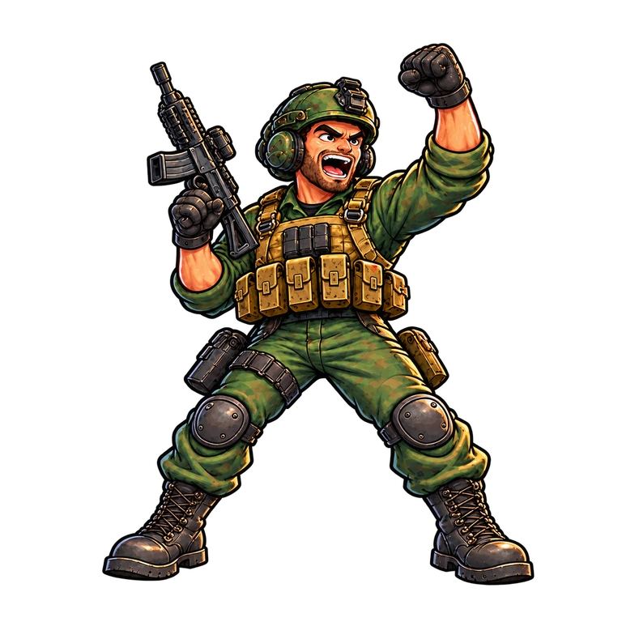
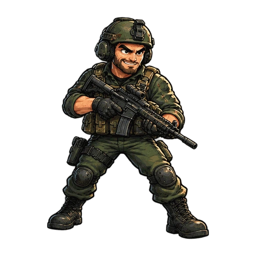
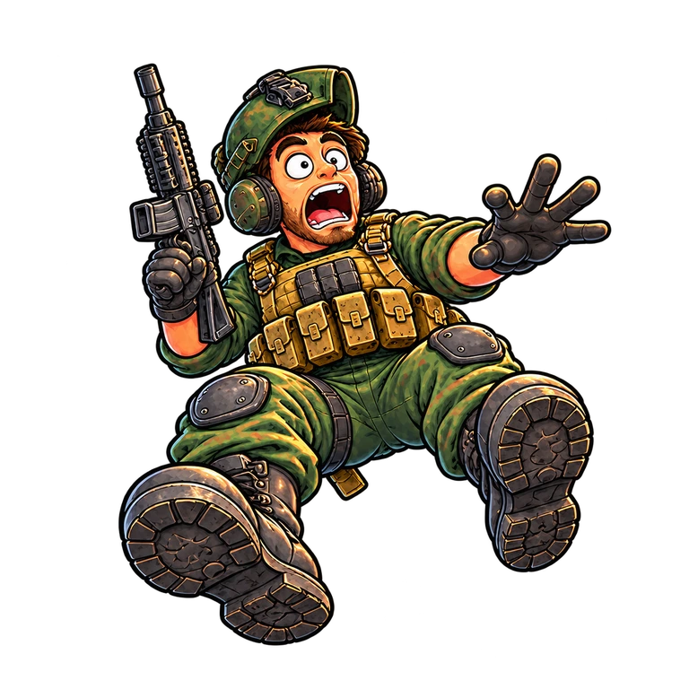

## The zombie horde (for style and scale)

The ordinary zombies are a ragged, desaturated, army-surplus horde, with glowing yellow eyes. They set the baseline for how realistic and gritty the bosses should look.

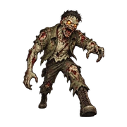
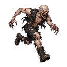
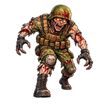
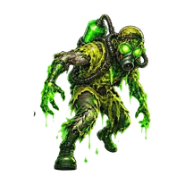
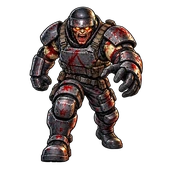
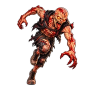
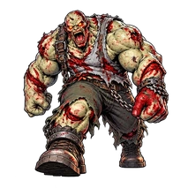
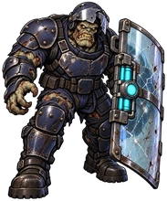
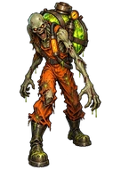
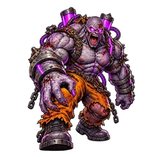

# Part 3: The bosses

## 1. Jordan: Fallen Firefighter (wave 2, 2 forms)

**Scene colour:** #ff9a36 (the glow, the backdrop and the name stamp use this colour)

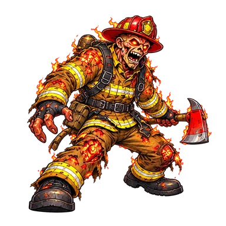
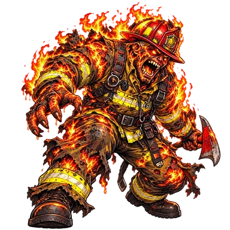

**Who he is:** a firefighter who held the line against a blaze and lost. Now he is on fire again, in a worse way.

**Appearance:** a zombie firefighter in a red helmet and a tan turnout coat with yellow reflective stripes. His skin is charred and his face is skull-like. He carries a red fire axe. In form 2 he is completely engulfed in flames.

### Arrival
1. **Warning:** red flash and klaxon. Behind the hazard tape, a silhouette with a firefighter's helmet and axe, edged in flame.
2. **Joey reacts**
   - Picture: Joey's face lit orange from off-screen. His eyes are wide and his lips are parted. He drops his gun an inch.
   - IN GAME, Joey: "JORDAN?! Mantis got to him too."
   - PROPOSED extra beat, Joey, quietly: "Mate… you're on fire."
3. **Boss reveal**
   - Picture: Jordan walks out of a wall of smoke, his coat smouldering, his eyes flickering green. His axe drags a line of sparks along the floor.
   - IN GAME, Jordan: "Everything burns eventually."
   - Sound: a low, slow roar of fire under the heartbeat, then the heavy impact.

### Mutation (form 2 of 2)
- Picture: his coat catches, flames climb his arms and his whole body ignites. He throws his head back and the green in his eyes flares.
- IN GAME: "The fire is spreading!" and then "Jordan is fully ignited!"
- Sound: a whoomph of ignition and a rising roar.

### Boss down
- Picture: the flames die out. Jordan sinks to his knees, soot-black and human again, his helmet on the ground. The green glow leaves his eyes.
- IN GAME, Jordan: "Tell them... I held the line."
- IN GAME, Joey: "You did. Mantis is next."
- Sound: the victory fanfare, with the fire fading under it.

### Joey down
- Picture: Joey on one knee, Jordan standing over him with his axe held low and a wry grin.
- IN GAME, Jordan: "You should've brought a hose."

## 2. Glowing Humanity: Radiant Test Subject (wave 4, 2 forms)

**Scene colour:** #9fff57 (the glow, the backdrop and the name stamp use this colour)

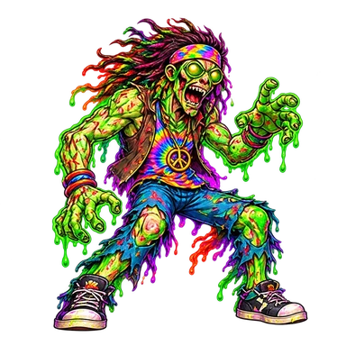
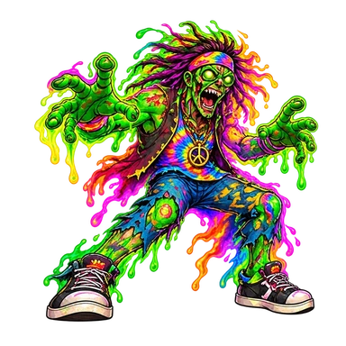

**Who he is:** a test subject who glows. He is cheerful, which is the unsettling part.

**Appearance:** a raver zombie with rainbow dreadlocks and a headband. He wears a tie-dye shirt with a peace sign, torn jeans and trainers. His skin glows green and dripping neon slime covers him. In form 2 the colours are wilder and slime in every neon colour floods over him.

### Arrival
1. **Warning:** red flash. A green-yellow glow bleeds in around the hazard tape.
2. **Joey reacts**
   - Picture: Joey squints and shields his eyes with his hand as a green light washes over his face.
   - IN GAME, Joey: "GLOWING HUMANITY?!"
   - PROPOSED extra beat, Joey, to himself: "Of course he's glowing."
3. **Boss reveal**
   - Picture: a figure in a haze of neon, with colour cycling through the slime on his skin. His dreadlocks swing.
   - IN GAME, Glowing Humanity: "I'm gonna make you glow, Joe."
   - Sound: a deep hum under the music that rises in pitch.

### Mutation (form 2 of 2)
- Picture: the slime bursts into every neon colour, colour floods the panel and the figure swells with light.
- IN GAME: "The radiation is spiking!" and then "Full neon mutation. Finish it!"
- Sound: a rising electrical whine that cuts out on a flash.

### Boss down
- Picture: the light drains out of him in one rush. He is dim, normal-sized and slumped, with the green gone from his eyes.
- IN GAME, Glowing Humanity: "Ah man... who turned the lights out?"
- IN GAME, Joey: "Mantis does not get another test subject."

### Joey down
- Picture: the whole panel white-hot, with Joey a dark shape in the glare.
- IN GAME, Glowing Humanity: "Ah, look — Joe got the glow."

## 3. Debo: Iron Enforcer (wave 6, 2 forms)

**Scene colour:** #f1c25d (the glow, the backdrop and the name stamp use this colour)

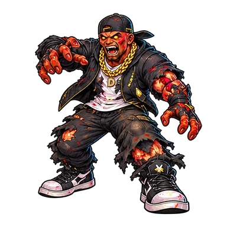
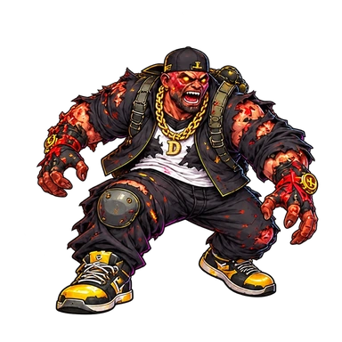

**Who he is:** a huge, calm bruiser with a chain. The threat is in how calm he is.

**Appearance:** a big man in a backwards black cap and a heavy gold chain necklace. He wears an open black jacket over a white tee, baggy black trousers and trainers. His skin is a glowing red-orange. In form 2 his jacket is shredded, he wears a knee pad and yellow trainers, and red cracks glow across his skin.

### Arrival
1. **Warning:** red flash. Heavy footsteps shake the hazard tape.
2. **Joey reacts**
   - Picture: Joey's face, eyes wide and jaw tight. The floor shakes and dust falls past him.
   - IN GAME, Joey: "DEBO?! This just got serious."
   - PROPOSED extra beat: Joey checks his belt.
3. **Boss reveal**
   - Picture: a low angle on Debo, huge, with his chain wrapped around his fist. A barrel sits at his feet. He cracks his neck.
   - IN GAME, the tease: "Joey better tuck that chain in... here come Debo."
   - Sound: slow heavy footsteps in time with the heartbeat, then the impact.

### Mutation (form 2 of 2)
- Picture: his jacket tears, red cracks split across his skin and his eyes burn green. He grows bigger and picks up a second barrel.
- IN GAME: "Debo is still coming!" and then "Armour cracked. Keep the pressure on!"
- Sound: cloth and metal tearing, and a low growl.

### Boss down
- Picture: he drops to one knee, the chain slips from his hand, and the barrel rolls away.
- IN GAME, Debo: "Smack my punk ass."
- IN GAME, Joey: "Big man is down. Keep moving."

### Joey down
- Picture: Debo stands over him and the chain swings back and forth.
- IN GAME, Debo: "Who else want some Debo?"

## 4. Caffeinated Sloth: Overcaffeinated Test Subject (wave 8, 2 forms)

**Scene colour:** #cb9b6c (the glow, the backdrop and the name stamp use this colour)

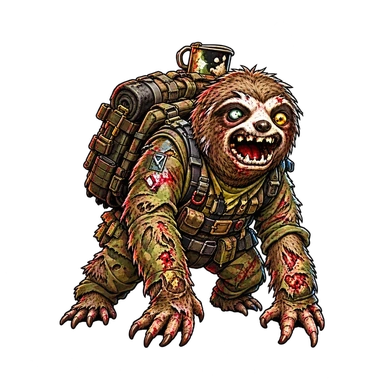
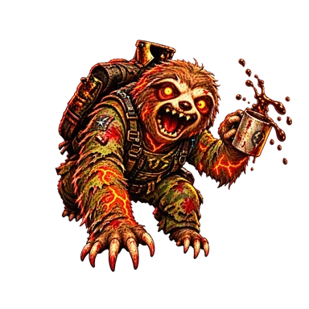

**Who he is:** a zombie sloth who should be slow and isn't. The comedy is his slow voice against his speed.

**Appearance:** a sloth on all fours with big claws and a wild stare. He wears a tactical backpack with straps and a coffee cup on top. In form 1 he is olive-brown. In form 2 his fur and veins glow orange and he holds a coffee mug that is spilling.

### Arrival
1. **Warning:** the klaxon is quickly overtaken by a fast, jittery coffee-bean rattle.
2. **Joey reacts**
   - Picture: Joey's head turns a fraction too slowly while the background blurs past him.
   - IN GAME, Joey: "Is that CAFFEINATED SLOTH?!"
   - PROPOSED extra beat: "Sloths are slow. SLOTHS ARE SLOW."
3. **Boss reveal**
   - Picture: the sloth crawls into frame on all fours, his backpack cup rattling. His eyes are wide and shaking, with a green pinprick pupil.
   - IN GAME, Caffeinated Sloth: "One coffee... isn't enough."
   - Sound: a slow drawn-out voice over a frantic ticking.

### Mutation (form 2 of 2)
- Picture: coffee cups pile around him, his arms blur and he vibrates into an after-image, glowing orange.
- IN GAME: "The caffeine is kicking in!" and then "Full frenzy. Keep firing!"
- Sound: a rising espresso-machine hiss and a frantic drum fill.

### Boss down
- Picture: he slows, finally, to a sloth's speed. He reaches for a cup that is empty and sags.
- IN GAME, Caffeinated Sloth: "Need... one... more... coffee..."
- IN GAME, Joey: "That was not slow at all."

### Joey down
- Picture: the sloth, very still and very calm. For once he looks smug.
- IN GAME, Caffeinated Sloth: "Decaf? Never. You're slower than me."

## 5. Disco Man: The Last Dance (wave 10, 2 forms)

**Scene colour:** #e98aff (the glow, the backdrop and the name stamp use this colour)

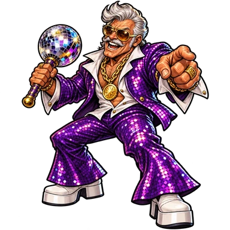
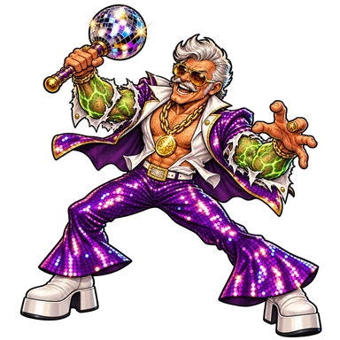

**Who he is:** one of Joey's mates, still dancing, with a mirror-ball staff. His theme is a different music track.

**Appearance:** an older man with swept-back silver hair and sunglasses. He wears a purple sequin suit with a wide white collar, a gold medallion, flared trousers and white platform boots. He holds a staff topped with a mirror ball. In form 2 his shirt is torn, one hand drips green slime and his pose is wilder.

### Arrival
1. **Warning:** red flash with a sweep of coloured disco light across the tape.
2. **Joey reacts**
   - Picture: Joey's face lit in pink and blue. A smile starts and then he stops himself.
   - IN GAME, Joey: "DISCO MAN?! He's still got the moves!"
   - PROPOSED extra beat: Joey reluctantly taps his foot.
3. **Boss reveal**
   - Picture: a spotlight comes on and a mirror ball spins above. Disco Man strikes a pose with his mirror-ball staff.
   - IN GAME, Disco Man: "come on the lads let's show em how it's done"
   - Sound: the disco track fades in under the warning, with a record scratch on the reveal.

### Mutation (form 2 of 2)
- Picture: the lights go from pink to red, the mirror ball cracks and the bass drops. Slime creeps up his hand and his moves get faster and more aggressive.
- IN GAME: "The rhythm is changing!" and then "He's turned the bass up!"
- Sound: the track drops into a heavy bass half-time.

### Boss down
- Picture: the music cuts out and the lights come up to plain white. He sits on the floor with his mirror-ball staff beside him.
- IN GAME, Disco Man: "joey you little toe rag"
- IN GAME, Joey: "Last orders, Disco."

### Joey down
- Picture: a spotlight on the floor where Joey fell, and Disco Man's silhouette leaning over.
- IN GAME, Disco Man: "ah…you alright joey?"

## 6. Fat Amy: Brainwashed Bruiser (wave 12, 3 forms)

**Scene colour:** #ff83bd (the glow, the backdrop and the name stamp use this colour)

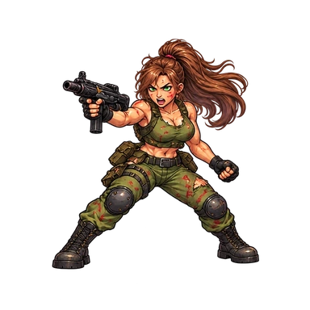
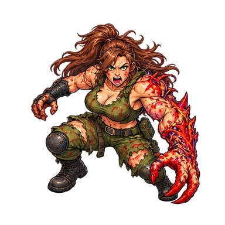
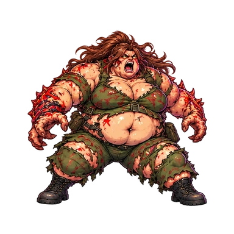

**Who she is:** a loving friend turned into a tank. Her scenes are the saddest of the set, because she still sounds like herself.

**Appearance:** in form 1 she is a fit woman with a long brown ponytail, a green crop top, camo trousers, knee pads and an SMG. In form 2 her hair is wild and one arm has become a huge red clawed limb. In form 3 she is much larger and bloated, her clothes are tearing and her mouth is wide open in a roar.

### Arrival
1. **Warning:** red flash with a whine of incoming missiles.
2. **Joey reacts**
   - Picture: Joey's mouth falls open and his gun drops.
   - IN GAME, Joey: "OMG... is that FAT AMY?!"
   - PROPOSED extra beat, very small: "Not Amy…"
3. **Boss reveal**
   - Picture: Amy in her first form, looking almost normal, with green in her eyes and her SMG held low. That is the horror.
   - IN GAME, Fat Amy: "Come here... my little crumpet."
   - Sound: a heavy tread and a slow, sweet music-box note under the doom build.

### Mutations (forms 2 and 3)
- **Form 2:** her arm swells into a huge red claw and her hair whips loose.
  - IN GAME: "Amy is changing..." and then "She is getting bigger. Keep firing!"
- **Form 3 (final form, Joey appears in the panel):** she is much larger, her clothes bursting and her eyes blazing. Joey is small in the corner, horrified.
  - IN GAME: "Final form. Do not let her through!"
  - Sound: a deep groan, then a charging stomp.

### Boss down
- Picture: the mutation falls away and Amy stands in her normal form, human and tired, her hair messy. She looks at Joey with real eyes.
- IN GAME, Fat Amy: "Don't you love me anymore, Joey?"
- IN GAME, Joey: "I'll love you forever, my biotch ❤️"
- Sound: the victory fanfare, kept gentle.

### Joey down
- Picture: Amy looming, with a very wide smile.
- IN GAME, Fat Amy: "Hmmm... I love the taste of that little crumpet."

## 7. Dr Mantis: Harvest Master (wave 14, 3 forms)

**Scene colour:** #92e158 (the glow, the backdrop and the name stamp use this colour)

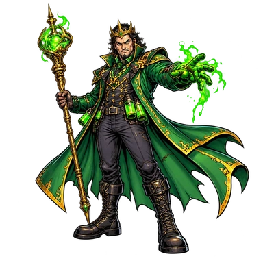
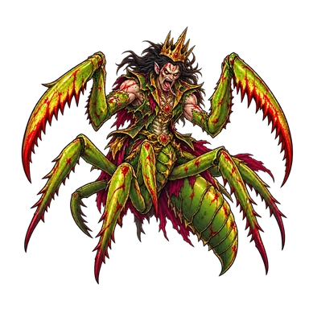
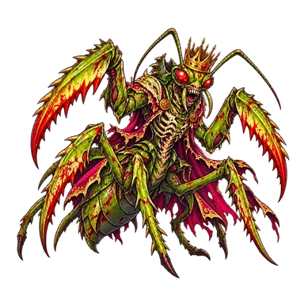

**Who he is:** the villain. He wants to be King of Proctology. His scenes should feel like the climax: grander and darker, but still with the game's sense of humour.

**Appearance:** in form 1 he is a tall man with long dark hair, a green velvet coat with gold trim and black boots. He holds a staff topped with a green flame and green slime magic crackles around his hand. In form 2 he is a crowned mantis-human hybrid with huge scythe forelegs and red and green wings. In form 3 he is a full giant mantis with antennae and red eyes.

### Arrival
1. **Warning:** red flash. A long, low alarm and the hazard tape peels away.
2. **Joey reacts**
   - Picture: Joey's face in a green wash, his jaw set. This is the one boss he isn't scared of. He is angry.
   - IN GAME, Joey: "DR MANTIS... this ends NOW."
3. **Boss reveal**
   - Picture: a throne room of surgical steel. Mantis wears a crown and king's robes, one gloved hand raised and his staff glowing green.
   - IN GAME, Dr Mantis: "It's time for your surgery, Joseph Robertson."
   - Sound: the doom build at its largest, then the impact on his name.

### Mutations
- **Form 2:** his crown slips as mantis limbs unfold from his back and the coat splits.
  - IN GAME: "His crown is down — something is happening!" and then "Half human. Half mantis. Keep shooting!"
- **Form 3 (final form, Joey appears in the panel):** a full mantis, huge, standing among smaller mantis minions.
  - IN GAME: "FULL MANTIS FORM!"
  - Sound: a screech and chitin cracking.

### Boss down
- Picture: Mantis collapses, the crown rolling across the floor. The green glow goes out of every zombie in the background. Joey stands in the dust.
- IN GAME, Dr Mantis: "The harvest... cannot end here..."
- IN GAME, Joey: "Mantis is down. Infinite survival starts now."
- Sound: the biggest victory fanfare of the game, with a hold on the last chord.

### Joey down
- Picture: Mantis standing over Joey, claws wide, looking down at him like a surgeon over a patient.
- IN GAME, Dr Mantis: "You gotta bow to the Mantis."

## Deliverables checklist for each boss

- Warning scene: 1 picture (the silhouette behind hazard tape).
- Joey reacts: 1 picture of Joey with the boss-specific expression.
- Boss reveal: 1 picture of the boss's first form, ideally 2 to 3 frames for a slow push-in.
- Mutation: 1 picture per new form. The final form of a 3-form boss needs Joey beside it (Fat Amy and Dr Mantis).
- Boss down: 1 picture of the boss defeated.
- Joey down: 1 picture of the boss gloating.
- Optional: a single short motion loop (smoke, glow, sparks) for each scene.

# Part 4: Console skin specs

A skin is the picture that frames the game: the metal or plastic "console" around the screen. The screen, the buttons, the numbers and the text are all drawn by the game on top of the skin. So a skin is **one picture plus a few colours**.

## What you deliver for a new skin

1. **One picture:** 900 × 1600 px, portrait, WebP or PNG, named `console-<id>.webp`. Aim for under 300 KB. The existing skins are 75 to 293 KB.
2. **A few settings:** the id, the display name, the window numbers and five colours (explained below).

Three template files are in `docs/skin-template/`:

- `console-skin-template.png`: a guide you can paint over.
- `console-skin-template-on-toxic.png`: the same guide drawn on the Toxic skin, so you can see how it lines up.
- `skin-layout.json`: all the numbers on this page, in a file.

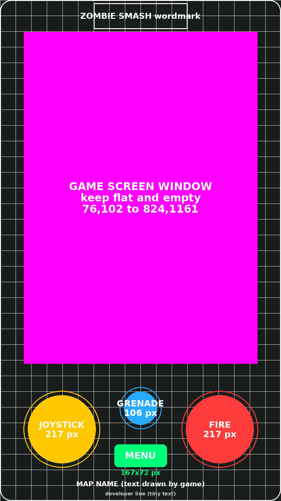
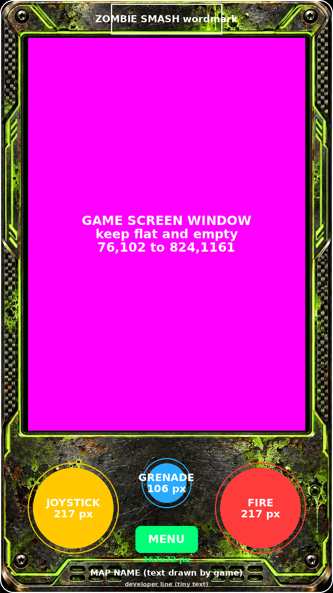

## Where everything goes

The game is laid out on a base grid of 375 × 667 px and the skin picture is 900 × 1600. That is a scale of 2.4 across and 2.3988 down. The table gives both sets of numbers, so you can work in either one.

| Element | Centre or position (art px) | Size (art px) | Size (layout px) | Notes |
| --- | --- | --- | --- | --- |
| Whole picture | 0,0 | 900 × 1600 | 375 × 667 | Portrait only |
| Game screen window | 76,102 to 824,1161 | 748 × 1059 | 311.6 × 441.5 | Flat and empty. The game draws the screen here |
| Joystick | centre 198,1371 | 217 across | 90.2 across | A round control, drawn by the game |
| FIRE button | centre 704,1371 | 217 across | 90.2 across | A round control, drawn by the game |
| Grenade button | centre 450,1303 | 106 across | 44.2 across | A round control, drawn by the game |
| MENU button | centre 450,1455 | 167 × 72 | 69.6 × 30.1 | A rounded rectangle, drawn by the game |
| Map name | centre y 1545 | text about 270 wide | text about 112 wide | Text drawn by the game, centred |
| Developer line | centre y 1570 | very small text | very small text | Text drawn by the game, centred |
| ZOMBIE SMASH name | x 300 to 600, y 10 to 92 | 300 × 82 | 125 × 34 | Text drawn by the game, centred at the top |
| Outer corners | all four | radius 36 | radius 15 | The picture is clipped to rounded corners |

## Rules for the picture

- **The window:**
  - The game screen covers the window area completely, and the game adds its own thin dark outline and a coloured glow around it. Keep the window area flat. Anything painted inside it is hidden.
  - You can put the window at slightly different coordinates in your own picture. The game stretches the frame around it to fit (it cuts the picture into 9 pieces and stretches the 8 outer pieces).
  - **If your window is at 76,102 to 824,1161 nothing is stretched.** The further it is from that, the more your frame details get stretched, so keep frame ornaments simple near the window edges.
  - The window numbers are written as `[left, top, right, bottom]` in art px.
- **The controls:**
  - They are drawn on top of the picture. Paint a flat, slightly recessed area behind each one, with at least 14 px of clear margin around the circle so the control looks seated in a socket.
  - Keep the lower deck (below y 1190) calmer and darker than the frame, so the buttons stay readable.
- **The text:** keep the map name and developer line areas plain and dark enough for white text. The name at the top should have a calm area behind it.
- **The edges:**
  - The picture is also blurred and darkened to fill the area outside the console on bigger screens. Avoid pure white or very bright edges.
  - Keep real detail at least 40 px from the corners, because the corners are rounded and clipped.
- **Transparency:** the Ember skin uses transparency outside its rounded shape. Every other skin is a solid picture. Both work.

## The colours

Every skin sets five colours. Write them as hex codes, such as `#58ff49`.

| Setting | What it colours | Guidance |
| --- | --- | --- |
| `accent` | The glow around the game screen, the word SMASH, the MENU button's text and outline, menu headings and the boost bar | Make it readable on near-black: roughly the colour of the lights on your frame |
| `fire` | The FIRE button | A strong colour. It must stand out from the deck around it |
| `grenade` | The grenade button | A different hue from `fire` |
| `stick` | The joystick knob | A metal, bone or accent-matched tone |
| `bleed` | A dark base colour for the skin | Supplied with every skin. It is not currently visible in the game |

Pick `fire` and `grenade` so they look different to people with colour blindness (for example a warm red and a cool blue), and make sure the knob colour does not match either.

## Settings for the existing skins

All existing skins use the same console, so these skins are a good place to look for style. `win` is `[left, top, right, bottom]` in art px. The three secret skins are only unlocked by cheat mode.

| Skin | id | win | accent | fire | grenade | stick |
| --- | --- | --- | --- | --- | --- | --- |
| Toxic | `toxic` | [63, 98, 836, 1165] | #58ff49 | #ef3042 | #159de8 | #d8a34e |
| Splatter | `splatter` | [63, 98, 835, 1138] | #ff4a55 | #ff3848 | #4077ff | #d7b376 |
| Hazard | `hazard` | [63, 98, 835, 1241] | #ffd23e | #e73f36 | #257ac7 | #e1aa3b |
| Electro | `electro` | [63, 100, 835, 1195] | #55cfff | #e74859 | #20bfff | #7cd4ff |
| Circuit | `circuit` | [63, 98, 835, 1216] | #55ffd2 | #eb3b4c | #13bddd | #70e4c6 |
| Carbon Ops | `carbon` | [63, 98, 836, 1137] | #e9bb65 | #ed3342 | #168dd5 | #dfa952 |
| Arctic Rescue | `arctic` | [49, 130, 850, 1171] | #8acaff | #d94452 | #278fd5 | #dad5b3 |
| Midnight Disco | `neon` | [45, 132, 853, 1096] | #eb85e8 | #f33668 | #33b9f5 | #d994e7 |
| Ember Ops | `ember` | [62, 98, 836, 1137] | #ff7b2d | #ff3d2e | #2387cc | #e39a3d |
| Rustyard (secret) | `rustyard` | [63, 98, 836, 1165] | #65e6cd | #e15e40 | #168da9 | #d4a375 |
| Void Reactor (secret) | `void` | [63, 98, 836, 1165] | #bc8aff | #dc408e | #677cff | #ac8fe6 |
| Warzone (secret) | `warzone` | [63, 98, 836, 1165] | #d4c57f | #d94835 | #307aa2 | #bdb275 |

The existing skins, for reference:

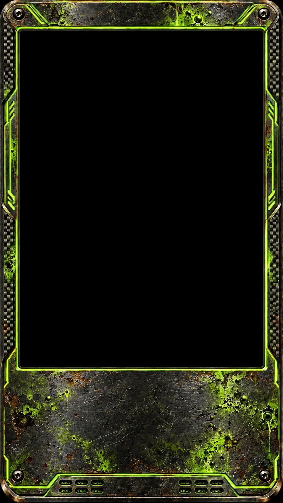
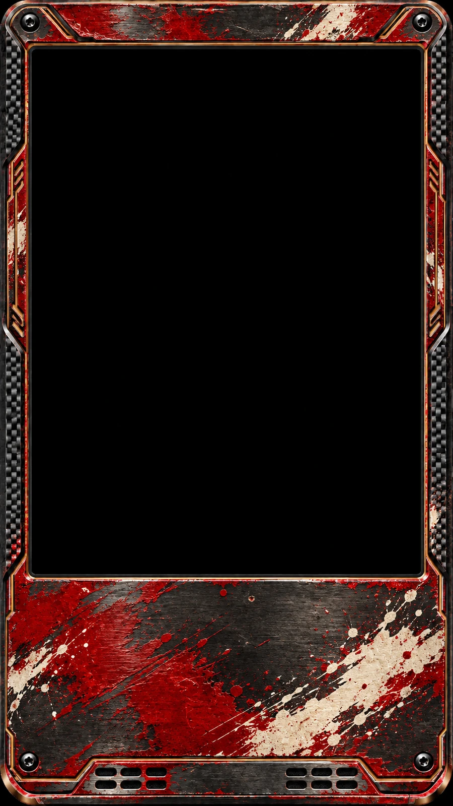
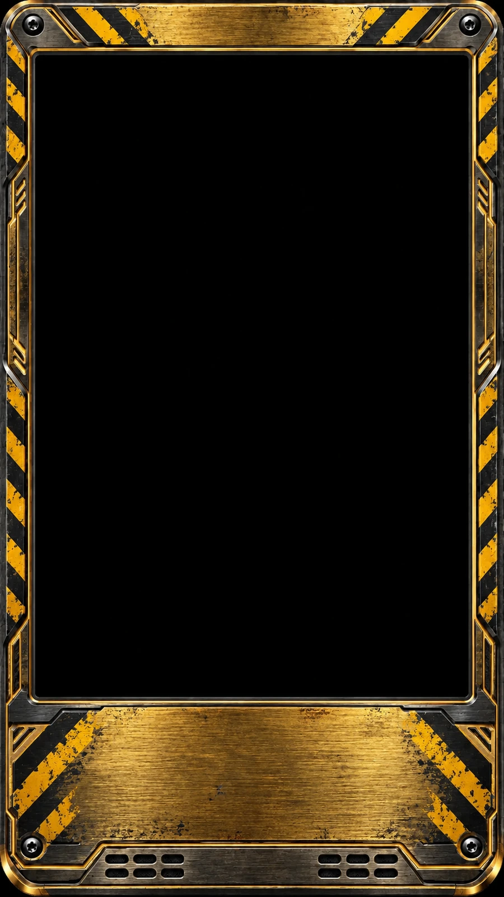
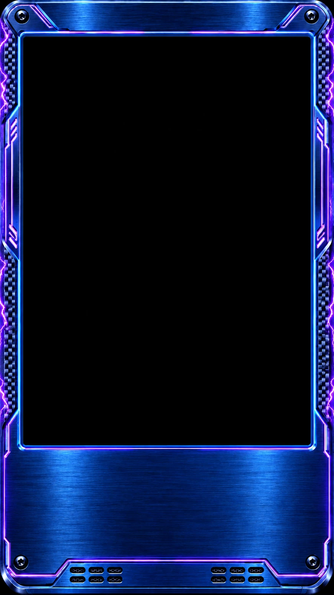
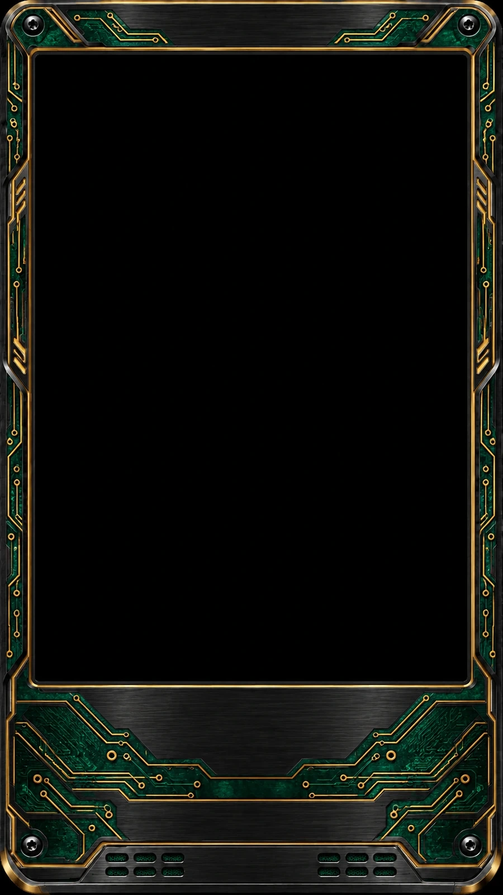
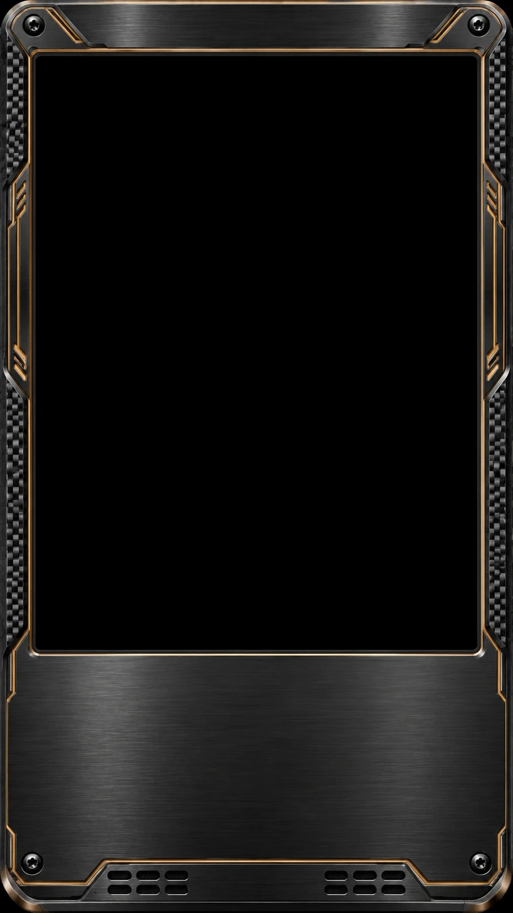
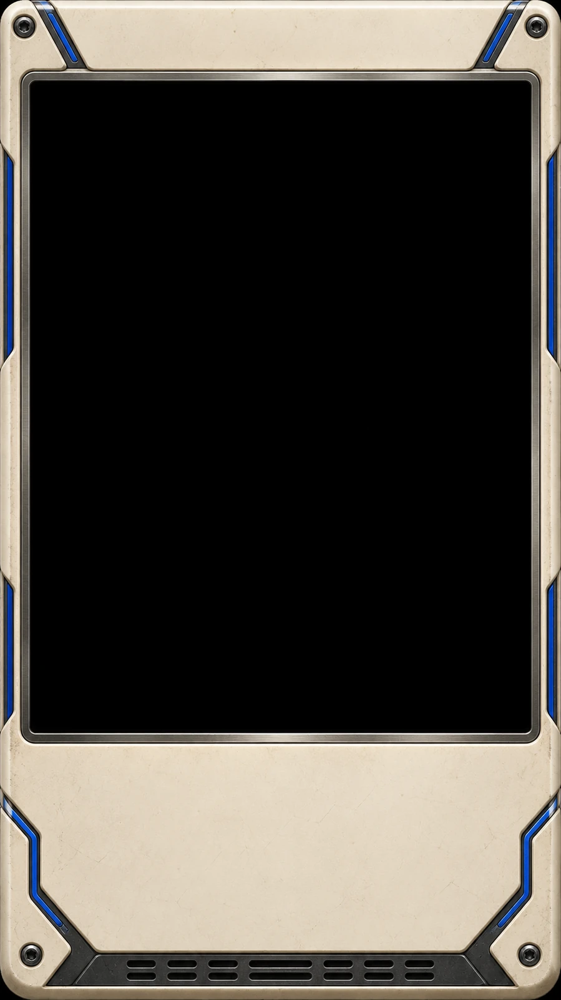
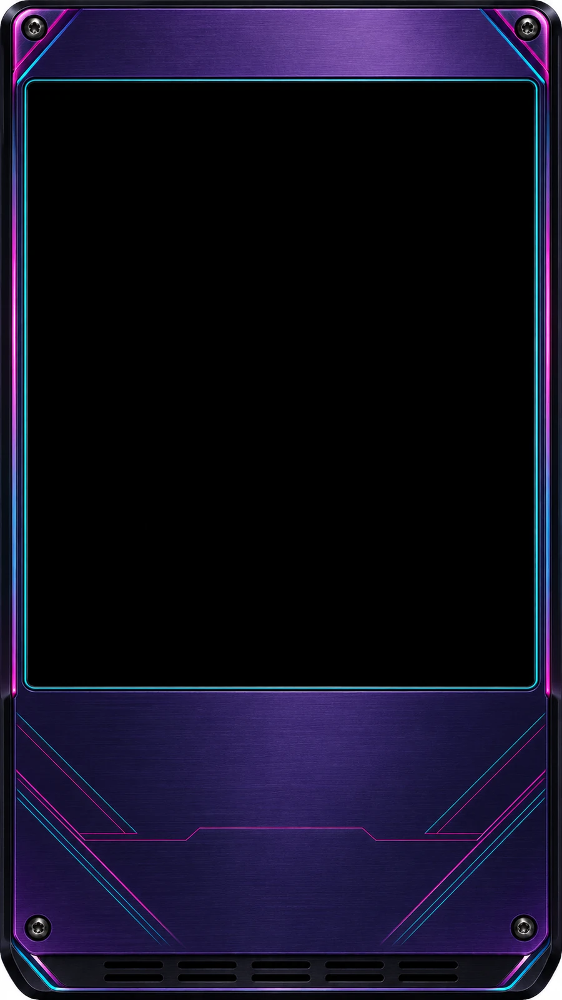
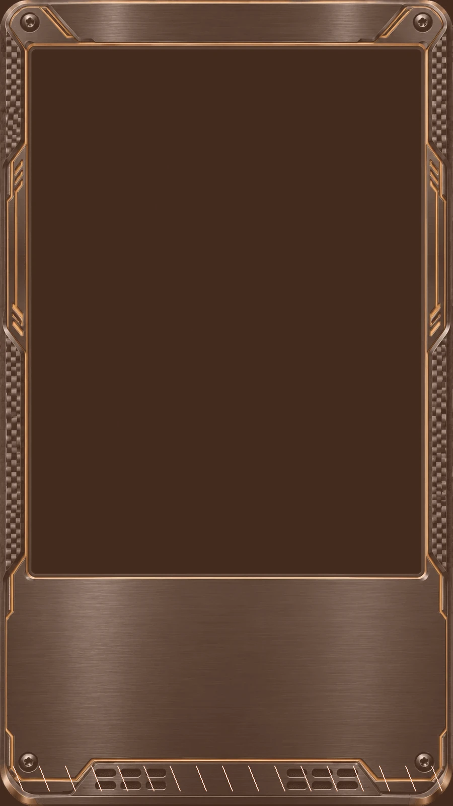
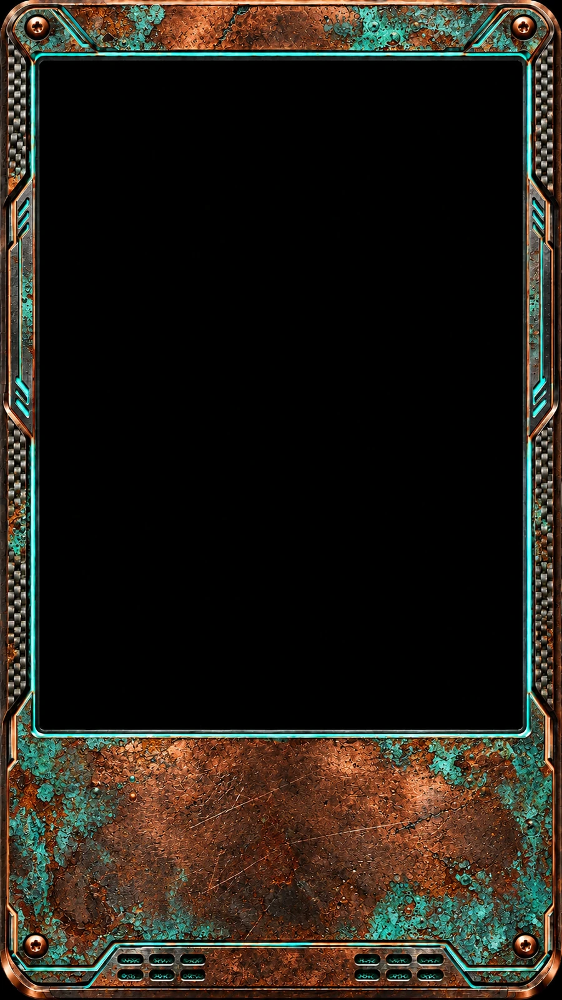
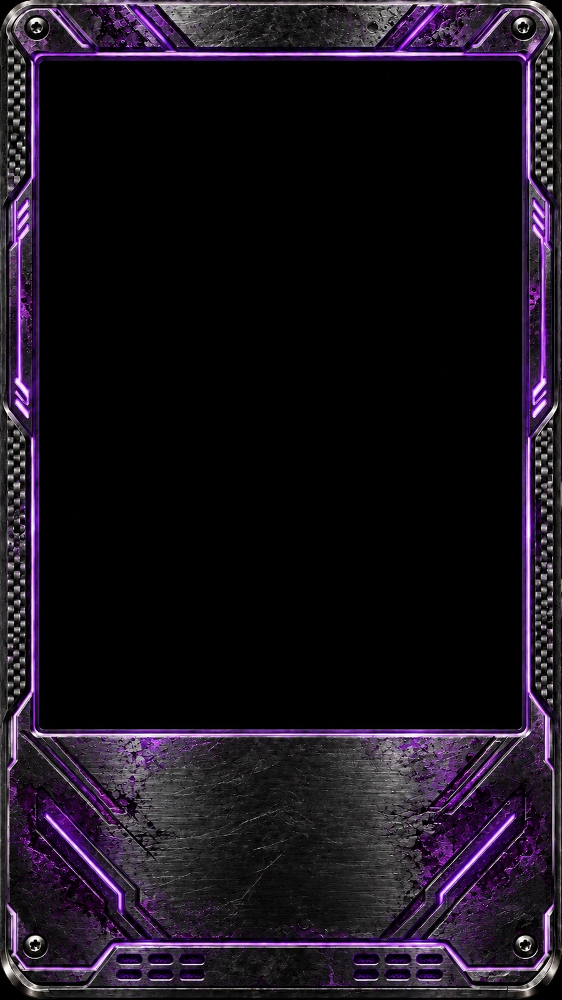
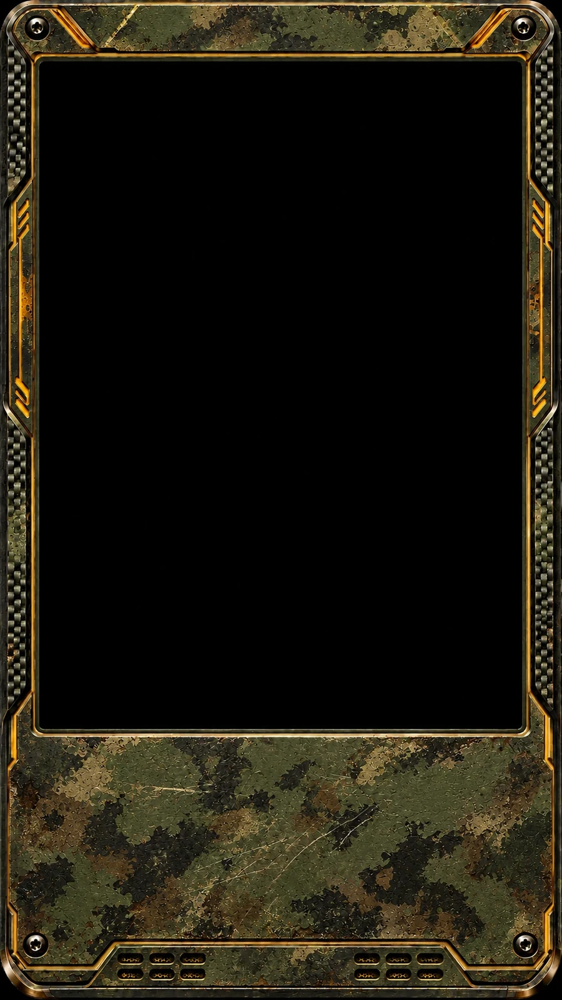

## Checklist for each new skin

- One 900 × 1600 picture, named `console-<id>.webp`, under about 300 KB.
- The `win` numbers: `[left, top, right, bottom]`.
- Five colours: `accent`, `fire`, `grenade`, `stick` and `bleed`.
- A display name and an id (lower case letters only).
- A check on a phone: the window flat, the controls sitting in their sockets, text readable.
